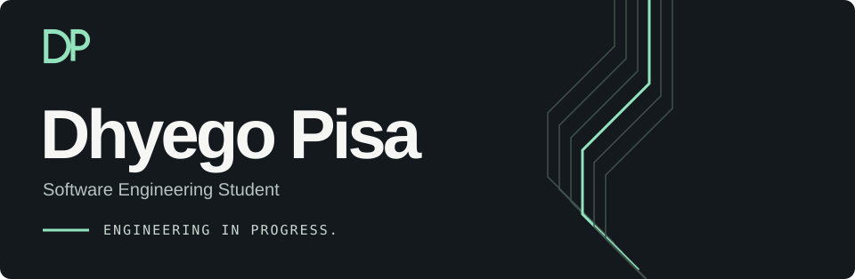
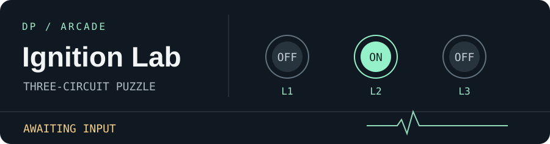

## Play Ignition Lab

[](https://github.com/dhyegopisa/dhyegopisa/blob/main/arcade/play-2.md)

[**Start the engine →**](https://github.com/dhyegopisa/dhyegopisa/blob/main/arcade/play-2.md) · Flip pairs of lights until all three are on. Can you find the two-move cold start?

## The developer

I’m Dhyego Pisa, a software engineering student. My projects start with questions I can answer in code. In DRIVE STATS, that question is simple: how far did a car travel on each litre of fuel? As I study systems architecture, I want to get better at explaining the decisions between a question like that and a working application.

## Selected work

### [DRIVE STATS](https://github.com/dhyegopisa/DRIVE-STATS)

A fuel-consumption calculator built around two measurements: distance travelled in kilometres and fuel used in litres. The [calculator interface](https://github.com/dhyegopisa/DRIVE-STATS/blob/main/index.html) shows how units, labels and input fields define the problem before any calculation happens.

### [Hot Wheels](https://github.com/dhyegopisa/Site-HotWheels)

A multi-page HTML project for practising navigation and form design.

<details>
<summary>Take a three-file code tour</summary>

1. [Home](https://github.com/dhyegopisa/Site-HotWheels/blob/main/index.html) introduces the theme and links the pages.
2. [Registration](https://github.com/dhyegopisa/Site-HotWheels/blob/main/cadastro.html) groups the fields for a new registration.
3. [Contact](https://github.com/dhyegopisa/Site-HotWheels/blob/main/contato.html) gives a different task its own page.

</details>

### [Python notebook](https://github.com/dhyegopisa/exercicios-python)

Twenty-five exercises in five sets, moving from variables and conditions through loops to lists. My [object-oriented programming studies](https://github.com/dhyegopisa/POO) explore how to organise Python code around classes and objects.

## Engineering process


For a calculator, that loop starts with the units. Sketch the two inputs, build the smallest useful calculation, then ask what should happen when someone enters zero litres.

## Engineering roadmap

| Stage | Focus |
| --- | --- |
| In practice | Python for logic exercises. HTML and CSS for web pages. |
| Studying | Object-oriented programming and how to divide responsibilities between classes. |
| Next | Add tests for boundary cases in a small project and document one architecture decision in English. |

<details>
<summary>developer.json</summary>

```json
{
  "name": "Dhyego Pisa",
  "fieldOfStudy": "Software Engineering",
  "interests": ["software development", "systems architecture"],
  "longTermGoal": "Build software on an international engineering team"
}
```

</details>

## Development log

| Portfolio edition | Change |
| --- | --- |
| v0.2 | Added DRIVE STATS and a roadmap connecting current coursework to the next engineering questions. |
| v0.1 | Published a guided tour of Hot Wheels alongside the Python notebook. |

[GitHub profile](https://github.com/dhyegopisa) · [All repositories](https://github.com/dhyegopisa?tab=repositories) · [Contribution history](https://github.com/dhyegopisa#js-contribution-activity)

---

**END OF FILE — NOT THE END OF DEVELOPMENT.**
