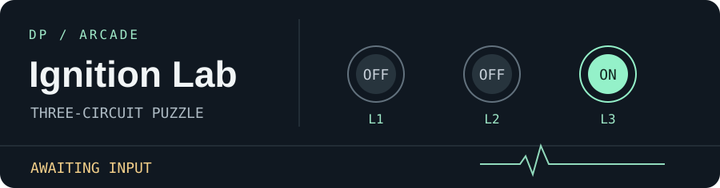

# Ignition Lab

**Objective** · Turn all three lights on. Each switch flips both lights wired to it. Pressing it again reverses the move.

| Switch | Wiring |
| --- | --- |
| [**Press A**](play-7.md) | Left + centre |
| [**Press B**](play-2.md) | Centre + right |

Show a hint

The centre light belongs to both switches. Flipping it twice restores its original state.

[Reset](play-2.md) · [Exit](https://github.com/dhyegopisa)
